# DevRecruit — Guida operativa del POC

**Cos'è questa guida.** Descrive l'applicazione così com'è oggi e spiega come si usa, non come è fatta: cosa fa ogni pagina, dove si trovano le cose, quale è l'ordine dei passi e cosa si vede a ogni passaggio. È pensata per una demo con il responsabile e per ragionare insieme sulle aree da migliorare.

**A chi serve.** A chi presenta il POC (per seguire un percorso lineare), a chi lo prova (per non perdersi tra le pagine) e a chi lo sviluppa (per vedere il flusso dall'esterno, con gli attriti ancora presenti).

> **Nota.** Le schermate sono state raccolte su un ambiente di verifica con dati di esempio. I nomi di candidati, posizioni e utenti sono fittizi.

---

## 1. Il concetto in una frase

L'applicazione trasforma una **posizione aperta** in una **decisione di assunzione**, raccogliendo prove su una **candidatura**: CV, test, colloqui e schede degli intervistatori. Ogni schermata dice qual è il prossimo passo.

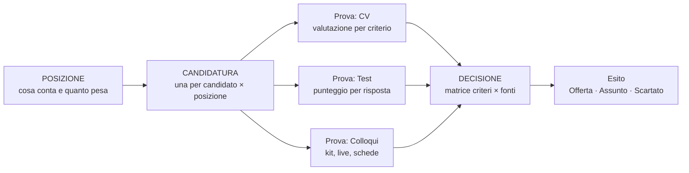

**Le due entità da tenere a mente:**

| Entità | In una frase | Dove si gestisce |
|---|---|---|
| **Posizione** | L'offerta di lavoro: dettagli, scheda di valutazione, quiz, guide colloquio | `/dashboard/positions` |
| **Candidatura** | Il percorso di una persona per una posizione: fase, prove, responsabile | `/dashboard/applications` |

La stessa persona può avere **più candidature**, una per posizione, con fasi diverse.

---

## 2. La mappa dell'applicazione

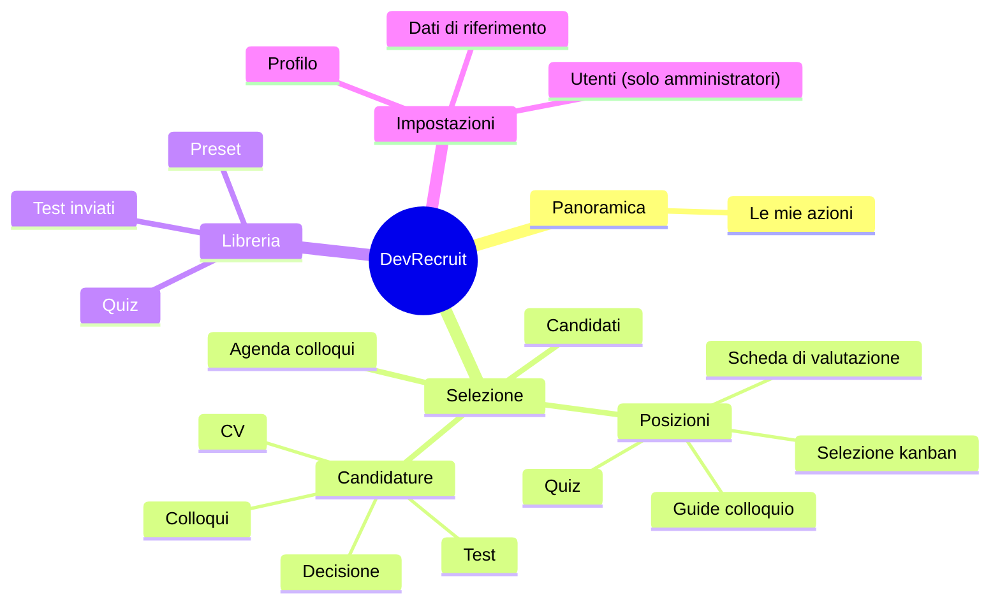

### Cosa trovo in ogni voce

| Voce di menu | A cosa serve | Cosa ci trovi dentro |
|---|---|---|
| **Le mie azioni** | La homepage operativa: cosa aspetta te | Test da valutare, candidature ferme da più di 7 giorni, posizioni con setup incompleto, colloqui senza kit pronto, schede da compilare |
| **Posizioni** | Preparare l'offerta | Dettagli · **Scheda di valutazione** · **Selezione (kanban)** · Quiz · **Guide colloquio** |
| **Candidature** | Seguire tutte le persone | Tabella con ricerca, filtro per fase/posizione, "Solo le mie"; si apre la pagina della candidatura |
| **Candidati** | Anagrafica della persona | Dati, flag "Non ricontattare", elenco delle sue candidature, valutazioni |
| **Agenda colloqui** | La giornata degli intervistatori | Colloqui pianificati e in corso, filtro "Solo i miei", pulsanti **Prepara** e **Live** |
| **Quiz** | Libreria dei test | Creazione manuale o con AI, domande riusabili, invio |
| **Test inviati** | Monitorare i test | Stato per candidato (in attesa, completato, valutato), valutazione AI |
| **Preset** | Modelli di generazione | Parametri per la generazione delle domande |
| **Utenti** (Impostazioni, solo amministratori) | Gestire chi accede | Elenco con ricerca per nome o email, ruolo, email verificata, stato, data di creazione, ultimo accesso e sessioni attive; **Nuovo utente**; dettaglio con dati, ruolo, verifica email, reimposta password, blocca/sblocca, sessioni |

**Come si legge una pagina.** In alto a sinistra il titolo e il contesto (per esempio il nome del candidato e la posizione), sotto la **card "Prossima azione"** quando la pagina è una candidatura, poi i tab. Le briciole di pane (Panoramica / Candidature / Dettaglio) riportano sempre al livello superiore.

### Accesso e utenti

**Due ruoli: Utente e Amministratore.** Il ruolo cambia solo chi vede **Impostazioni → Utenti**: ogni utente autenticato, amministratore o no, vede e modifica tutti i dati di selezione (posizioni, candidature, colloqui, decisioni).

- **Registrazione aperta.** Chiunque si registra da **Registrati** nella pagina di accesso. L'app non invia email: un nuovo account può accedere solo dopo che un amministratore ha attivato **Email verificata** dal suo dettaglio in Impostazioni → Utenti. Il nuovo utente avvisa l'amministratore con altri mezzi, fuori dall'app; finché la verifica non è attiva, l'accesso mostra "La tua email non è ancora verificata. Chiedi a un amministratore di verificarla per poter accedere."
- **Account creati da un amministratore.** In Impostazioni → Utenti → **Nuovo utente** l'amministratore indica nome, cognome, email, password iniziale, ruolo e **Email verificata** (attiva: l'utente entra subito). La password iniziale si comunica a mano.
- **La propria password.** Un utente autenticato la cambia da **Profilo → Cambia password**, indicando quella attuale. Una password dimenticata non si recupera via email: la reimposta un amministratore dal dettaglio utente (**Reimposta password**) e la comunica a mano.
- **Blocco.** Un amministratore blocca un utente indicando il motivo: l'utente non può più accedere, le sue sessioni aperte si chiudono e non compare tra i partecipanti proponibili per un colloquio. **Sblocca utente** gli restituisce l'accesso. Gli utenti non si eliminano mai: si bloccano.
- **Sessioni.** Il dettaglio utente elenca le sessioni attive: **Chiudi sessione** ne chiude una, **Chiudi tutte** le chiude tutte. Togliere la verifica email o reimpostare la password non chiude le sessioni aperte.
- **Regole di sicurezza.** Resta sempre almeno un amministratore attivo: l'ultimo non perde il ruolo e non si blocca. Nessuno blocca sé stesso né cambia il proprio ruolo o la verifica della propria email.

**Il primo amministratore.** `pnpm user:make-admin <email>` promuove ad amministratore un account già esistente (email verificata, account attivo); non crea mai account. In produzione si esegue insieme al rilascio di questa funzione, altrimenti nessuno può verificare le nuove registrazioni né gestire gli utenti. L'ordine è:

1. `pnpm db:migrate:deploy` sul database di produzione;
2. `pnpm user:make-admin <email>` con il `DATABASE_URL` di produzione;
3. il deploy dell'applicazione.

Gli altri amministratori si nominano dall'app, in Impostazioni → Utenti.

---

## 3. Percorso A — Preparare una posizione (una volta per ruolo)

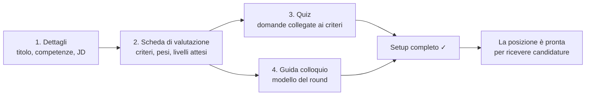

**Dove:** `/dashboard/positions` → **Nuova posizione** (oppure apri una esistente).

1. **Dettagli.** Titolo, tipo di contratto, livello di esperienza, competenze tecniche e soft. La descrizione può essere generata con AI; si può modificare a mano.
2. **Scheda di valutazione.** È il cuore della valutazione: i **criteri** con categoria (tecnico / soft / cultura), priorità (**indispensabile** o **preferibile**), **peso 1–5**, **livello atteso 1–5** e le **ancore** ("come suona una risposta debole / media / forte"). L'AI propone i criteri a partire da competenze e livello; ogni criterio si conferma o si modifica.
   - Se un criterio ha già raccolto voti o compare in un kit, **non si elimina: si archivia** (resta nelle decisioni già avviate, sparisce dalle nuove schede).
   - Cambiare un peso vale per le candidature non ancora decise: quelle decise conservano i pesi del momento della decisione.
3. **Quiz.** Il test della posizione. Si possono creare domande o generarle con AI; ogni domanda può essere **collegata ai criteri** della scheda: così il test produrrà prove per criterio.
4. **Guida colloquio.** Uno o più modelli (round), con sezioni (intro, esperienza, tecnico, comportamentale, domande del candidato, chiusura), minuti e domande con approfondimenti e ancore. "Genera dalla scheda" propone il modello a partire dai criteri.

**In alto resta una checklist**: Dettagli ✓ · Scheda ✓ · Quiz ✓ · Guida ✓. Una posizione può essere **Bozza**, **Aperta** o **Chiusa**: solo le aperte compaiono nel form pubblico. L'eliminazione è permessa solo se non ci sono candidature.

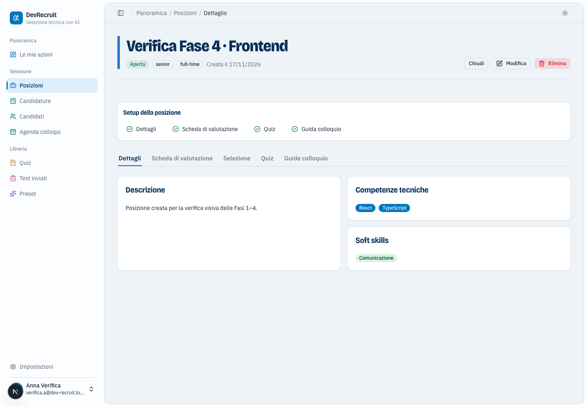

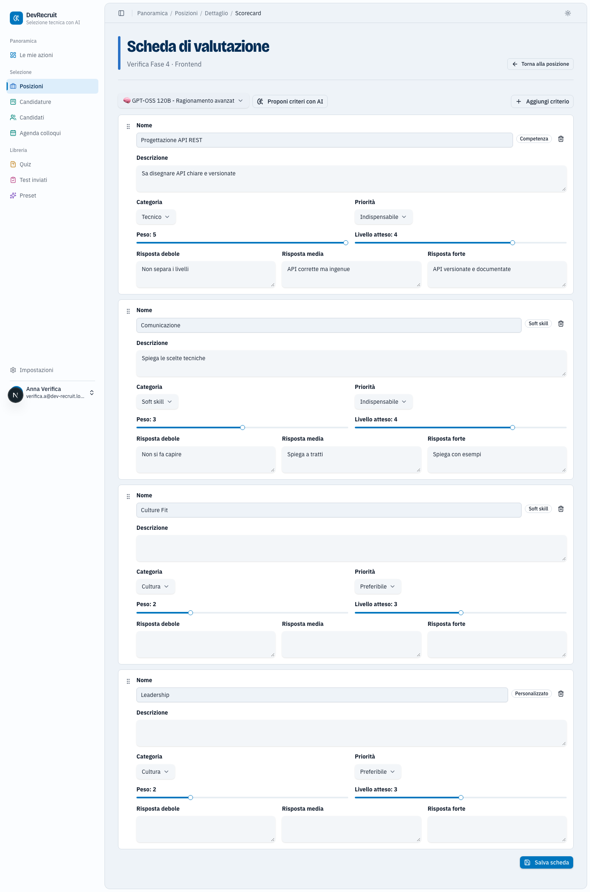

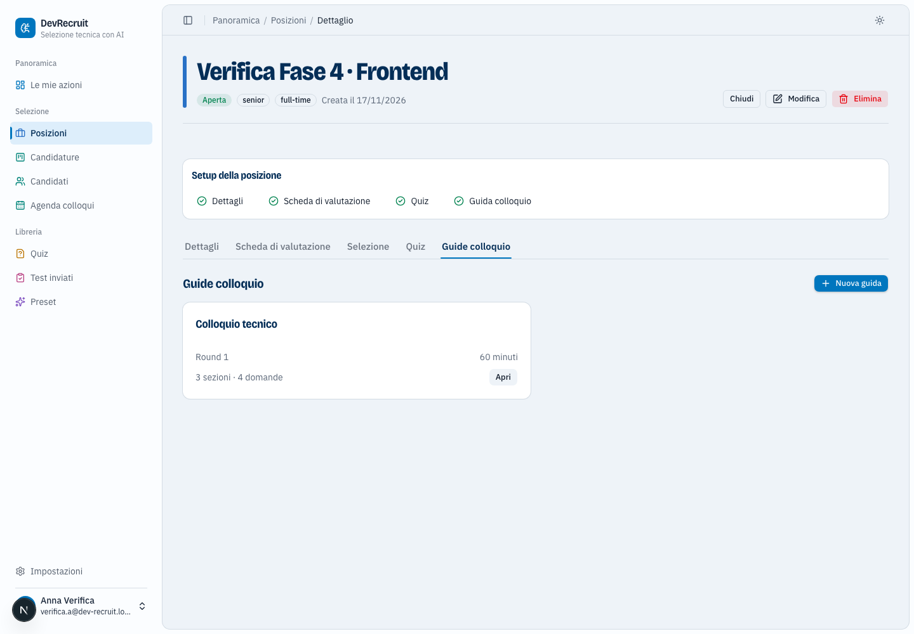

---

## 4. Percorso B — Far arrivare una candidatura

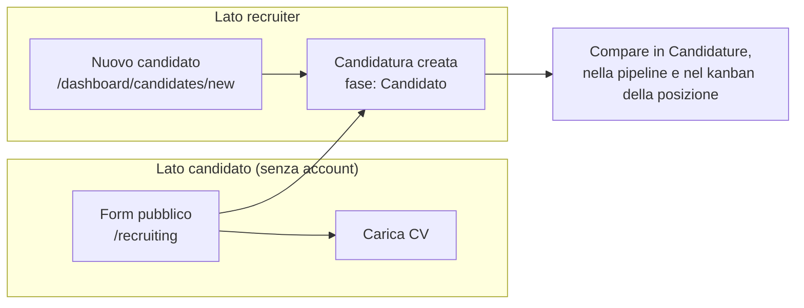

**Due modi per creare una candidatura:**

- **Form pubblico** (`/recruiting`): il candidato sceglie una posizione aperta, inserisce i dati e carica il CV. Se l'email esiste già, l'applicazione **aggancia la candidatura al candidato esistente** e aggiorna il CV; se è già candidato a quella posizione, non crea duplicati. La risposta mostrata è identica in tutti i casi.
- **Da dashboard** (`Candidati → Nuovo Candidato`): il recruiter inserisce i dati, carica il CV e sceglie una o più posizioni. Si crea una candidatura per ogni posizione.

La candidatura nasce in fase **Candidato**. Da lì in poi la fase avanza con le azioni (valutare il CV, inviare un test, pianificare un colloquio) e può sempre essere spostata a mano dal menu **Sposta fase**.

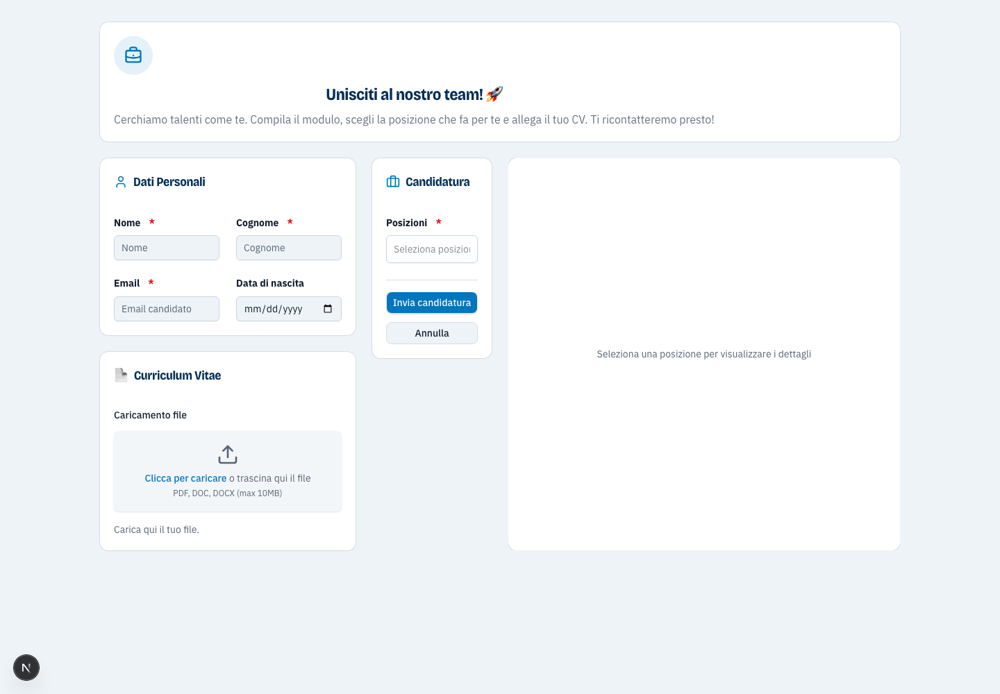

---

## 5. Percorso C — Seguire una candidatura

**Dove:** `Candidature` → clic sulla persona (oppure dal kanban della posizione).

La pagina ha sempre la stessa struttura:

- **Intestazione:** candidato, posizione, stepper delle fasi, responsabile ("Prendi in carico" / "Rilascia").
- **Card "Prossima azione":** calcolata dallo stato. È il punto di partenza consigliato.
- **Tab:** Panoramica · CV · Test · Colloqui · Decisione.

### Le fasi

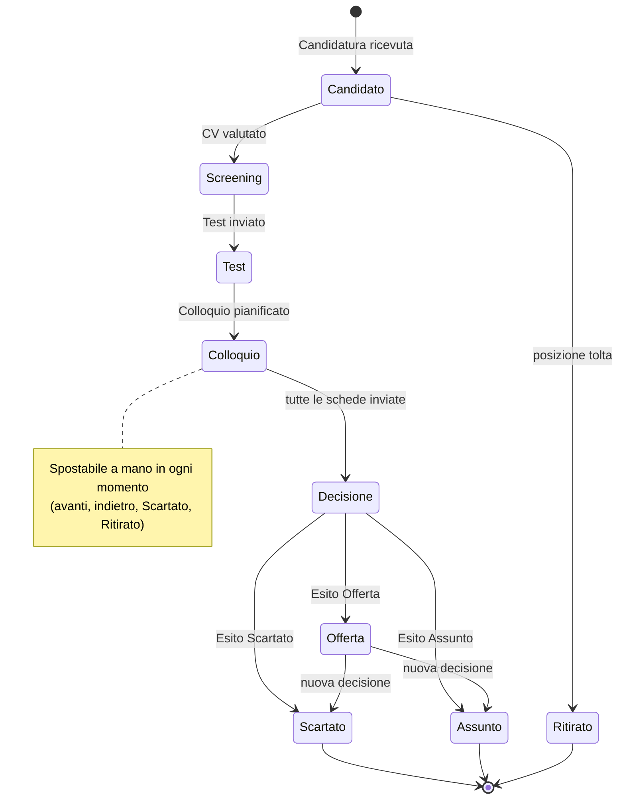

Regola pratica: **le azioni fanno avanzare la fase e non la fanno mai arretrare**; il recruiter può comunque correggere a mano da **Sposta fase**.

### La "Prossima azione" dice cosa fare

| Situazione | Card |
|---|---|
| CV caricato ma non valutato | **Valuta CV** |
| Fase Test senza test inviato | **Invia test** (quiz della posizione preselezionato) |
| Test completato senza valutazione | **Genera valutazione** |
| Fase Colloquio senza colloqui | **Pianifica colloquio** |
| Colloquio pianificato, kit in bozza | **Prepara colloquio** |
| Colloquio concluso, scheda mancante | **Compila scheda** |
| Tutte le schede inviate | **Vai alla decisione** |
| Nessuno dei casi sopra, candidatura aperta | **Passa a <fase successiva>** |
| Candidatura Assunto, Scartato o Ritirato | **Candidatura chiusa** (riapribile se Scartato o Ritirato) |

### Tab Panoramica — la cronologia delle prove

Elenca in ordine di tempo ciò che è successo: candidatura ricevuta, CV valutato, test inviato/iniziato/completato/valutato, colloqui pianificati/iniziati/conclusi, fase attuale. Ogni voce con link porta alla prova.

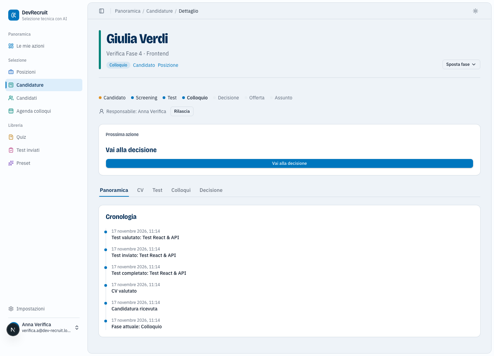

### Tab CV

Mostra il CV caricato, il **punteggio di fit 0–10**, punti di forza e aree di miglioramento, e la **valutazione per criterio** della scheda (1–5 con evidenza). La stessa persona mantiene le valutazioni delle altre candidature.

### Tab Test

I test inviati per quella candidatura con stato e link alla valutazione. Da qui si invia un nuovo test: si sceglie il quiz, si genera il link per il candidato e si segue lo stato.

- Il candidato risponde su `/recruiting/[token]`, senza account.
- La valutazione AI produce punteggio, punti di forza/debolezze e il **dettaglio per risposta** (punteggio 0–10, punti di forza, aree di miglioramento). Se il quiz è collegato ai criteri, il dettaglio diventa anche la prova del test per criterio nella Decisione.
- Se una valutazione non ha il dettaglio per risposta, "Ricalcola dettaglio risposte" lo ricostruisce senza cambiare il punteggio salvato.

### Candidature e kanban

- **Candidature** è la vista globale: ricerca, filtro per fase e posizione, "Solo le mie".
- **Posizioni → tab Selezione** è il **kanban**: una colonna per fase (Scartato e Ritirato insieme in "Chiuse"), una card per candidatura, con i test inviati, il responsabile e "Sposta fase" direttamente sulla card.

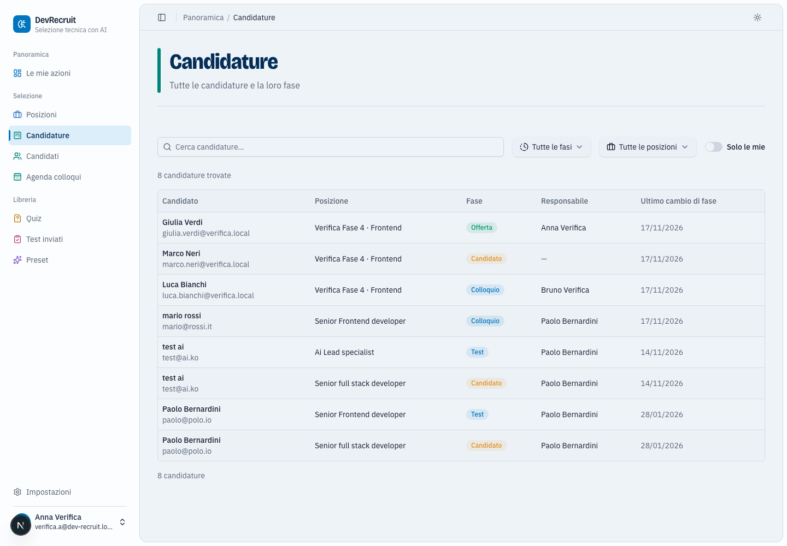

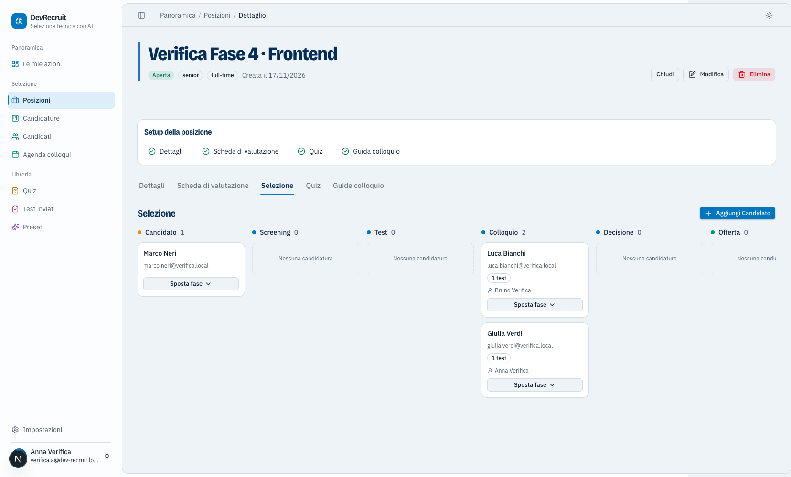

---

## 6. Percorso D — Il colloquio (pianifica → prepara → live → scheda)

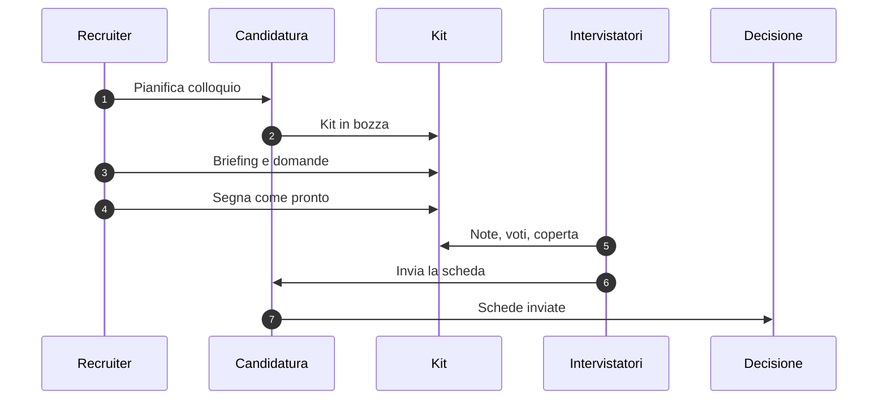

**Dove:** candidatura → tab **Colloqui** → **Pianifica colloquio**.

1. **Pianificazione.** Round, guida colloquio (obbligatoria), data e ora, durata, link della call, partecipanti con ruolo (Conduttore / Osservatore). Si crea il colloquio e il **kit in bozza**; la fase passa a **Colloquio**.
2. **Riepilogo e `.ics`.** L'app **non invia email**: mostra un riepilogo copiabile e un file `.ics` da condividere. Gli intervistatori vedono il colloquio in **Agenda colloqui** e in **Le mie azioni**.
3. **Preparazione.** Briefing e ipotesi da verificare; domande del modello + domande personalizzate con badge di origine (CV, Test, Round precedente, Manuale) e il **perché**; si possono modificare, riordinare, aggiungere, rimuovere. C'è la checklist (cosa comunicare, logistica) e il **promemoria legale fisso** sulle domande vietate. "Segna come pronto" chiude la preparazione.
4. **Modalità live.** A sinistra le sezioni con il **timer**. Al centro la domanda con approfondimenti e le tre ancore (debole/media/forte); nota rapida, voto 1–5, citazione, **Coperta** (condivisa). A destra la **copertura dei criteri**, con "Nessuna prova" finché non arriva evidenza e "Nessuna domanda" se il kit non copre un criterio. Note e voti si salvano da soli e restano in locale se cade la connessione.
5. **Scheda intervistatore.** Precompilata con i propri voti e note; raccomandazione finale; invio **bloccante** (dopo non si modifica più, nemmeno dall'autore). Note e voti non inviati degli altri non sono mai visibili; le schede già inviate sono in una sezione chiusa, con l'invito a leggerle dopo il proprio invio.

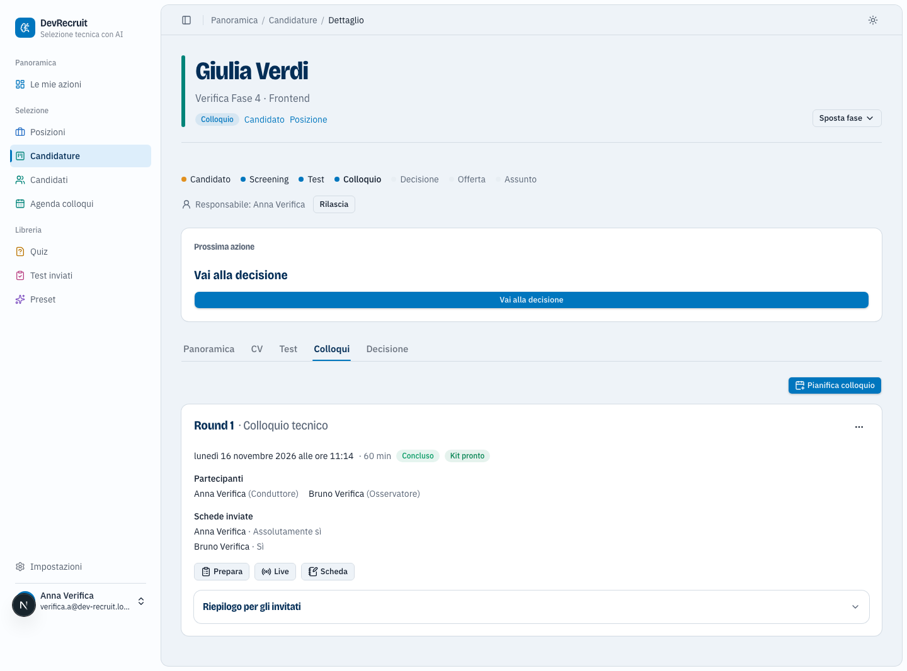

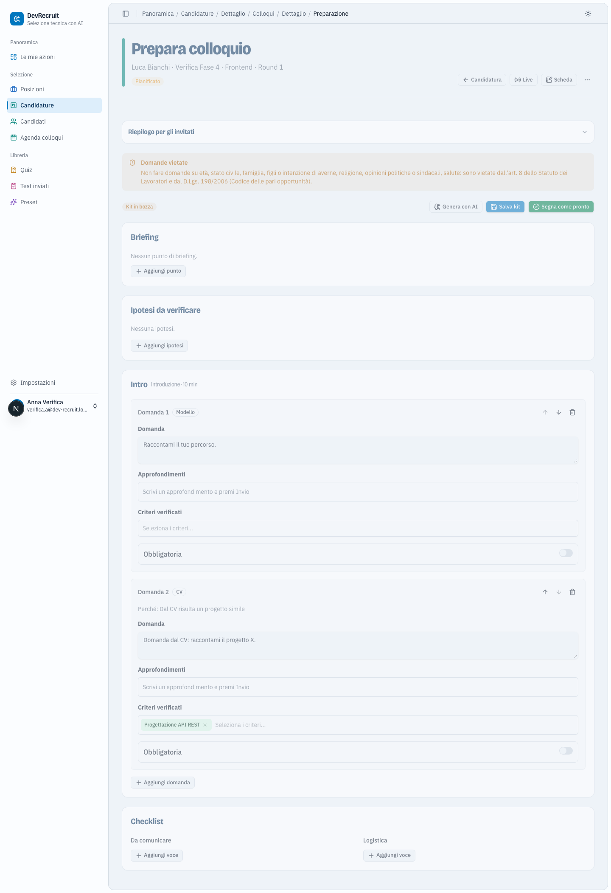

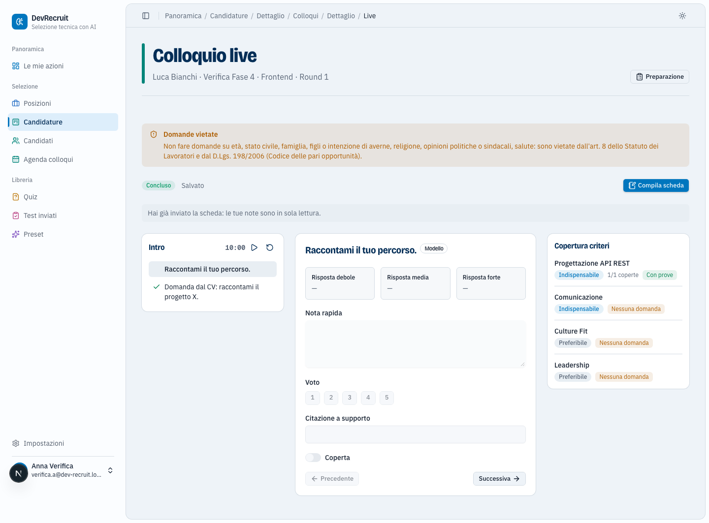

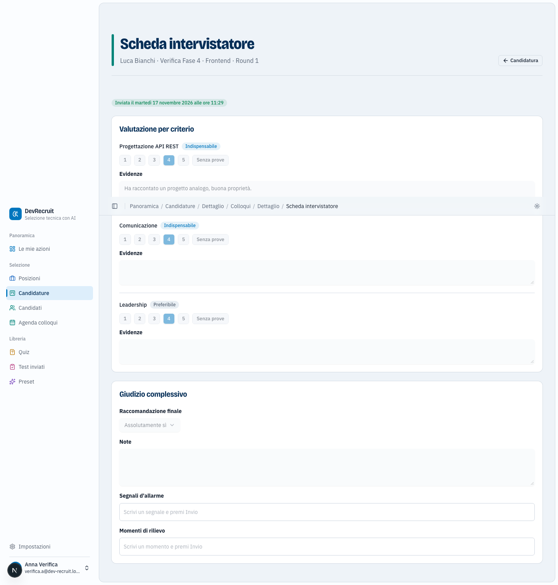

---

## 7. Percorso E — La decisione

**Dove:** candidatura → tab **Decisione** → **Apri la decisione**, oppure "Vai alla decisione" dalla prossima azione. URL: `/dashboard/applications/[id]/decision`.

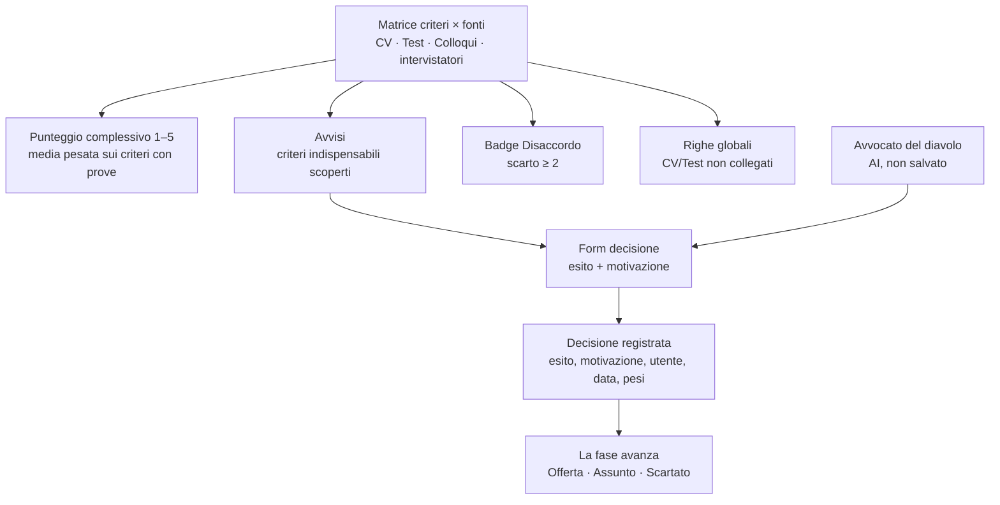

Cosa si vede:

- **Punteggio complessivo** su 5 con i pesi della scheda. Sotto la candidatura non decisa: "Pesi della scheda di valutazione"; dopo la decisione: "Pesi salvati con la decisione del …".
- **Matrice**: una riga per criterio, una colonna per fonte (CV, Test, ogni colloquio con la media, ogni singolo intervistatore con la sua raccomandazione), più Valore e Peso. Le celle senza prova sono evidenziate; i voti discordanti hanno il badge **Disaccordo**.
- **Criteri indispensabili da motivare**: un `must` senza prove o sotto il livello atteso **non azzera il punteggio**, ma deve essere affrontato nella motivazione (compare anche nel form "Da motivare").
- **Avvocato del diavolo**: chiede all'AI 3–5 motivi per cui l'esito scelto potrebbe essere sbagliato. È una proposta: non si salva.
- **Indipendenza**: chi è partecipante di un colloquio e non ha ancora inviato la propria scheda vede colonne, valori, punteggio e avvisi chiusi con "•••" e il pulsante **Mostra**.

**Registrare la decisione** salva esito, motivazione, utente, data e pesi usati, e porta la candidatura alla fase dell'esito. Su una candidatura Assunto, Scartato o Ritirato il form è disattivato ("Candidatura chiusa: riaprila per registrare la decisione"). Su Offerta si può registrare una nuova decisione (per esempio Assunto): l'ultima sostituisce la precedente.

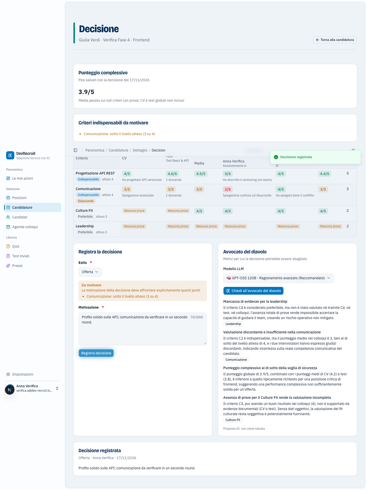

---

## 8. Il giorno per giorno

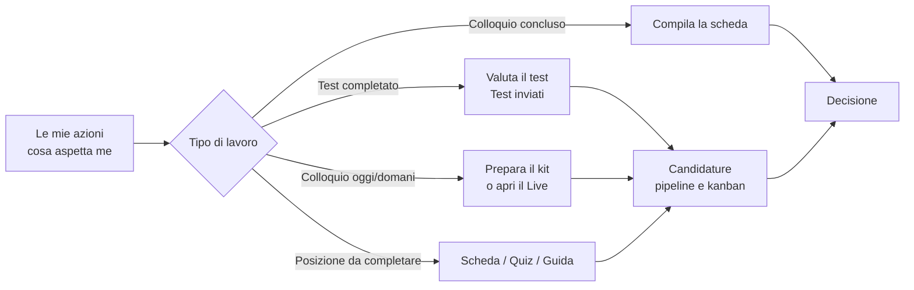

**Tre punti di ingresso, tre scopi:**

| Se devo… | Parto da | Poi |
|---|---|---|
| Sapere cosa fare adesso | **Le mie azioni** | Ogni riga porta all'azione |
| Vedere la situazione di tutte le candidature | **Candidature** | Filtri per fase/posizione, "Solo le mie" |
| Vedere una posizione nel dettaglio | **Posizioni → Selezione** | Kanban e "Sposta fase" |
| Gestire la giornata di colloqui | **Agenda colloqui** | Prepara / Live; filtro "Solo i miei" |

---

## 9. Dove interviene l'AI (e dove decide la persona)

| Momento | Cosa propone l'AI | Cosa fa la persona |
|---|---|---|
| Descrizione posizione | Testo della job description | Modifica e salva |
| Scheda di valutazione | Criteri, categorie, priorità, pesi | Conferma, modifica, archivia |
| Quiz | Domande (e collegamento ai criteri) | Rivede, modifica, salva |
| Guida colloquio | Sezioni e domande dalla scheda | Rivede, modifica, salva |
| Valutazione CV | Fit, punti di forza/debolezze, voto per criterio | Legge; può ricalcolare il dettaglio |
| Valutazione test | Punteggio e dettaglio per risposta | Legge; può ricalcolare il dettaglio |
| Kit colloquio | Briefing, ipotesi, domande dai CV/test/round precedenti | Conferma e salva il kit |
| Decisione | Avvocato del diavolo | Sceglie l'esito e scrive la motivazione |

**Regola costante:** la generazione AI **non salva mai da sola**. Tutto passa da una conferma umana. Le proposte non confermate non compaiono nelle altre pagine.

---

## 10. Glossario rapido (per chi guarda la demo)

| Termine | Significato |
|---|---|
| **Posizione** | L'offerta di lavoro |
| **Candidatura** | Il percorso di una persona per una posizione; è il perno dell'app |
| **Fase** | Candidato · Screening · Test · Colloquio · Decisione · Offerta · Assunto · Scartato · Ritirato |
| **Scheda di valutazione** | I criteri della posizione con pesi e livelli attesi |
| **Test** | Il quiz inviato al candidato (non è il colloquio) |
| **Colloquio** | La conversazione, con round e partecipanti |
| **Kit** | La preparazione del colloquio: briefing, domande, checklist |
| **Scheda intervistatore** | Voti e note di un intervistatore per un colloquio |
| **Decisione** | Esito registrato con motivazione e pesi usati |

---

## 11. Aree di miglioramento (osservate durante la verifica)

Questa sezione è deliberatamente schietta: serve a decidere cosa fare dopo il POC. Le voci sono emerse usando l'applicazione, non leggendo il codice.

### Attriti di flusso

| # | Osservazione | Impatto | Idee |
|---|---|---|---|
| 1 | **Nessuna email**: pianificazione e inviti passano da riepilogo copiabile e `.ics` | Alto in uso reale, accettabile in demo | Integrare invio email o calendario; conservare il riepilogo |
| 2 | **Le decisioni non hanno storico**: una nuova decisione sovrascrive esito, motivazione, utente, data e pesi | Alto per audit e GDPR | Tabella `ApplicationDecision` con storico e "decisione corrente" |
| 3 | **Indipendenza solo di vista**: le schede inviate sono leggibili da tutti e "Mostra" apre subito | Medio/alto per la correttezza del giudizio | Regola esplicita + traccia di chi ha aperto cosa; valutare blocco reale |
| 4 | **Nessun promemoria** per colloqui imminenti o kit non pronti: solo la dashboard | Medio | Notifiche in-app, digest, integrazione calendario |
| 5 | **Criterio archiviato non ripristinabile** dall'interfaccia | Basso/medio | Vista "Archiviati" con ripristino |
| 6 | **Stessa persona con due email**: l'email è unica, ma due indirizzi diversi creano due candidati e non esiste una fusione | Medio in import massivo | Procedura guidata di fusione in app |
| 7 | **Ruoli e accesso essenziali**: due soli ruoli (Utente / Amministratore) e ogni utente autenticato vede e modifica tutti i dati di selezione; senza email ogni nuova registrazione attende che un amministratore la verifichi e le password dimenticate si reimpostano a mano; non resta traccia di chi ha creato o modificato un utente | Medio se l'app esce dal POC | Ruoli per area; registro delle modifiche agli utenti; invio email per verifica e recupero password |
| 8 | **Il candidato non ha una guida di preparazione né feedback dopo il rifiuto** | Medio per l'esperienza | Fase 5 (`next-steps/FASE5_PLAN.md`) |

### Attriti di interfaccia

| # | Osservazione | Impatto | Idee |
|---|---|---|---|
| 9 | **Nessuna ricerca globale** tra candidati, posizioni e candidature | Medio con molti dati | Command palette (⌘K) |
| 10 | **Matrice della decisione larga**: su mobile richiede scroll orizzontale | Basso | Vista compatta o espansione per criterio |
| 11 | **La cronologia della candidatura non distingue i cambi di fase storici**: mostra solo la fase attuale | Basso/medio | Registrare gli eventi di fase |
| 12 | **Copertura criteri senza un riepilogo aggregato**: i criteri senza domanda sono visibili ma non c'è un avviso prima del colloquio | Basso | Avviso in preparazione ("3 criteri senza domande") |
| 13 | **Tabella della pipeline senza azioni multiple** (es. assegnare un responsabile a più candidature) | Basso/medio | Selezione multipla e azioni in blocco |
| 14 | **Stato della posizione "Chiusa" poco visibile** nelle liste | Basso | Filtro/etichetta più evidente |

### Attriti di contenuto e AI

| # | Osservazione | Impatto | Idee |
|---|---|---|---|
| 15 | **L'avvocato del diavolo non ha una soglia minima garantita** di motivi (il prompt ne chiede 3–5, il codice taglia a 5) | Basso | Validare il numero o mostrare un avviso |
| 16 | **I divieti legali sono solo nel prompt** (età, famiglia, religione, salute…) | Alto in uso reale | Controlli automatici sul testo delle domande + revisione |
| 17 | **Nessun registro delle chiamate AI** (modello, prompt, esito) per costi e audit | Medio/alto con l'AI Act | Log delle generazioni e delle conferme |
| 18 | **Il dettaglio per risposta può mancare** su una valutazione di test finché non si ricalcola a mano | Basso | Ricalcolo automatico in background |
| 19 | **Dati identificativi nei prompt**: sono già esclusi da kit e decisione, ma la trascrizione dei colloqui (Fase 5) riaprirà il tema | Da valutare con la Fase 5 | Anonimizzazione e consenso |

### Cosa funziona già bene (da mostrare)

- La **"Prossima azione"** riduce la domanda "e adesso?" a un pulsante.
- La **matrice criteri × fonti** rende visibile il motivo di una decisione, non solo il voto.
- Le **proposte AI con conferma umana** sono coerenti in tutto il prodotto.
- La **scheda inviata blocca la modifica** e conserva l'indipendenza degli intervistatori.
- Il **kanban per posizione** e la pipeline globale coprono due modi di lavorare (per ruolo e per persona).

---

## 12. Percorso consigliato per la demo (10–12 minuti)

1. **Le mie azioni** — "ecco cosa aspetta il recruiter" (30 s).
2. **Posizione** — checklist di setup, scheda (criteri e pesi), guida (30–60 s).
3. **Candidatura di Giulia** — prossima azione, tab, cronologia delle prove (1 min).
4. **Test** — invio e valutazione AI con dettaglio per risposta (1 min).
5. **Colloqui** — pianificazione, kit, modalità live con copertura criteri (2 min).
6. **Scheda intervistatore** — invio bloccante e indipendenza (1 min).
7. **Decisione** — matrice, avvisi sui criteri indispensabili, avvocato del diavolo, registrazione (2–3 min).
8. **Kanban e agenda** — il colpo d'occhio operativo (1 min).
9. **Aree di miglioramento** — le 3 priorità che proponi (1–2 min).

---

## 13. Domande frequenti ("dove trovo…?")

| Mi serve… | Vai a |
|---|---|
| Il punteggio complessivo di una candidatura | Candidatura → tab Decisione → **Apri la decisione** |
| Cambiare i pesi dei criteri | Posizione → **Scheda di valutazione** |
| Creare o modificare il quiz di una posizione | Posizione → tab **Quiz** |
| Preparare le domande di un colloquio | Candidatura → **Colloqui** → **Prepara** |
| Sapere quali criteri non hanno ancora prove | Live → **Copertura criteri**, oppure Decisione (celle "Nessuna prova") |
| Spostare una candidatura di fase | Candidatura → **Sposta fase**, oppure kanban della posizione |
| Vedere tutti i colloqui di domani | **Agenda colloqui** |
| Trovare il form che vede il candidato | `/recruiting` (posizioni aperte) e `/recruiting/[token]` (test) |
| Capire cosa ha fatto un candidato | Candidatura → **Panoramica** (cronologia) |
| Aggiungere un collega | Impostazioni → **Utenti** → **Nuovo utente** (solo amministratori) |
| Mi sono registrato ma non riesco ad accedere | Un amministratore deve attivare **Email verificata** dal tuo dettaglio in Impostazioni → Utenti |
| Ho dimenticato la password | Chiedi a un amministratore: la reimposta dal dettaglio utente (**Reimposta password**) |
| Non riesco ad accedere: email non verificata o account bloccato | Rivolgiti a un amministratore |

---

**Manutenzione.** Questa guida e la sua versione HTML (`docs/guida-operativa.html`) descrivono il comportamento attuale dell'applicazione e vanno aggiornate insieme, nello stesso commit, ogni volta che cambia qualcosa che descrivono: pagine, voci di menu, etichette, fasi, regole o limiti. Una schermata che non corrisponde più si rifà o si toglie.

*Guida non collegata dal README, per scelta: è un documento di lavoro per la demo e per la revisione del POC.*
